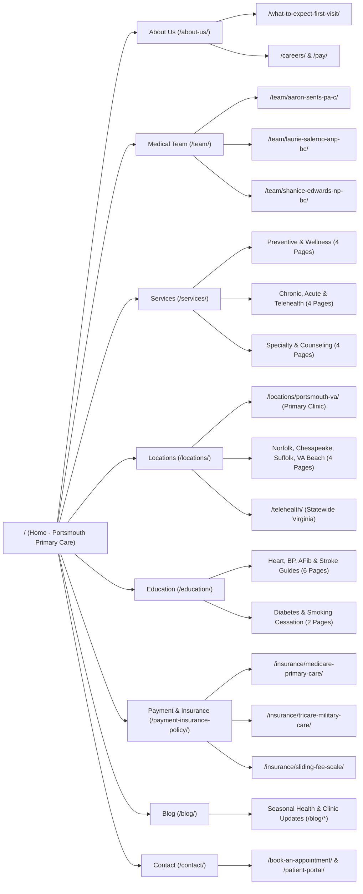
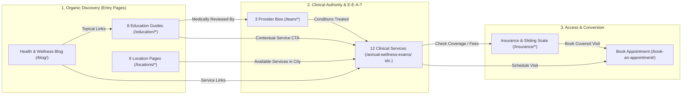

# Hampton Roads Primary Care (`htrpc.com`) — Full Site Structure & SEO Implementation Plan

## 1. Site Architecture & Internal Linking Map (Left-to-Right)

### 1A. Master Site Overview (Left -> Right)



### 1B. Internal Linking & Patient Conversion Flow (Left -> Right)



### 1C. Strategic Overview
- **Primary Clinic Location:** 355 Crawford Street, Suite 622, Portsmouth, VA 23704 (`(757) 516-7554`)
- **Primary Market:** Portsmouth, Norfolk, Chesapeake, Suffolk, Virginia Beach, and statewide Virginia via Telehealth.
- **Core SEO Objectives:**
  1. **Zero URL Regression:** Preserve all 23 existing indexable slugs from `https://htrpc.com/page-sitemap.xml` (including all 12 client clinical service URLs) so existing backlinks, citations, and Google Search Console equity carry forward without redirect loss.
  2. **First-Party Education Hub (`/education/*`):** Replace the live site's 8 outbound links to `cdc.gov` and `heart.org` under the **Education** menu with 8 authoritative, clinician-reviewed first-party condition guides written for Hampton Roads patients. This stops leaking visitors and PageRank while capturing high-volume chronic-care search traffic.
  3. **Local SEO Service-Area Architecture (`/locations/*`):** Build dedicated hyper-local landing pages for Portsmouth, Norfolk, Chesapeake, Suffolk, and Virginia Beach with driving directions to Crawford Street, transit/bridge-tunnel context, and local `MedicalClinic` schema.
  4. **E-E-A-T Clinician Profiles (`/team/*`):** Give each provider (Aaron Sents, PA-C; Laurie A. Salerno, ANP-BC; Shanice Edwards, NP-BC) an individual NPI-backed profile page with `Physician` / `MedicalBusiness` structured data, credentials, and authored/reviewed Education articles.

---

## 2. Live Header Navigation Structure (Implemented in `/concept/1`)

```text
[Hampton Roads Primary Care Logo]
├── Home (/)
├── About Us (/about-us/)
│   ├── About the Clinic (/about-us/)
│   ├── Our Medical Team (/team/)
│   ├── Aaron Sents, PA-C (/team/aaron-sents-pa-c/)
│   ├── Laurie Salerno, ANP-BC (/team/laurie-salerno-anp-bc/)
│   ├── Shanice Edwards, NP-BC (/team/shanice-edwards-np-bc/)
│   ├── What to Expect: First Visit (/what-to-expect-first-visit/)
│   ├── Careers (/careers/)
│   └── Online Bill Pay (/pay/)
├── Services (/services/)  [Client's 12 Live Clinical Services]
│   ├── Annual Wellness Exams (/annual-wellness-exams/)
│   ├── Chronic Disease Management (/chronic-disease-management/)
│   ├── Acute Illness Care (/acute-illness-care/)
│   ├── Preventive Health Screenings (/preventive-health-screenings/)
│   ├── Immunizations & Vaccinations (/immunizations-and-vaccinations/)
│   ├── Telemedicine Consultations (/telemedicine-consultations/)
│   ├── Women’s Health Services (/womens-health-services/)
│   ├── Men’s Health Services (/mens-health-services/)
│   ├── Management of Mental Health Conditions (/management-of-mental-health-conditions/)
│   ├── Minor Injury Treatment (/minor-injury-treatment/)
│   ├── Nutrition & Weight Management Advice (/nutrition-and-weight-management-advice/)
│   └── Health Education & Counseling (/health-education-counseling/)
├── Locations (/locations/)  [Local SEO Pillar]
│   ├── Portsmouth, VA — Primary Clinic (/locations/portsmouth-va/)
│   ├── Norfolk, VA Primary Care (/locations/norfolk-va/)
│   ├── Chesapeake, VA Primary Care (/locations/chesapeake-va/)
│   ├── Suffolk, VA Primary Care (/locations/suffolk-va/)
│   ├── Virginia Beach, VA Primary Care (/locations/virginia-beach-va/)
│   └── Virginia Telehealth Visits (/telehealth/)
├── Education (/education/)  [Our Own First-Party Content — Replaces External CDC/AHA Links]
│   ├── Patient Education Library (/education/)
│   ├── High Blood Pressure Guide (/education/high-blood-pressure/)
│   ├── Hypertension Care Plan (/education/hypertension-management/)
│   ├── Type 2 Diabetes & A1C Guide (/education/type-2-diabetes/)
│   ├── Heart Disease Prevention (/education/heart-disease-prevention/)
│   ├── Atrial Fibrillation (AFib) (/education/atrial-fibrillation/)
│   ├── Stroke Warning Signs & Care (/education/stroke-warning-signs/)
│   ├── Cardiac Arrest vs. Heart Attack (/education/cardiac-arrest-guide/)
│   └── Smoking Cessation Program (/education/smoking-cessation/)
├── Payment & Insurance (/payment-insurance-policy/)
│   ├── Payment & Insurance Policy (/payment-insurance-policy/)
│   ├── Medicare & Advantage Plans (/insurance/medicare-primary-care/)
│   ├── TRICARE & Military Families (/insurance/tricare-military-care/)
│   ├── Sliding Fee Scale & Self-Pay (/insurance/sliding-fee-scale/)
│   └── Pay Your Bill Online (/pay/)
├── Blog (/blog/)
├── Contact (/contact/)
└── [CTA] Patient Portal (OptiMantra Login)
```

---

## 3. Complete Page Inventory & URL Hierarchy (43 Pages Across 6 Pillars)

### Pillar 1: Core Clinic & Conversion Pages (9 Pages — Existing Live Slugs Preserved)
| URL Slug | Status | Target Primary Keyword | Schema Types |
| :--- | :--- | :--- | :--- |
| `/` | Built (`/concept/1`) | primary care portsmouth va | `MedicalClinic`, `Physician`, `FAQPage` |
| `/about-us/` | Live Slug (Redesign) | hampton roads primary care portsmouth va | `MedicalClinic`, `AboutPage` |
| `/contact/` | Live Slug (Redesign) | primary care clinic 355 crawford st portsmouth | `MedicalClinic`, `ContactPage` |
| `/book-an-appointment/` | Live Slug (Redesign) | schedule primary care appointment portsmouth va | `MedicalClinic`, `WebPage` |
| `/what-to-expect-first-visit/` | Live Slug (Redesign) | new patient primary care visit portsmouth va | `WebPage`, `FAQPage` |
| `/patient-portal/` | Live Slug (Redesign) | hampton roads primary care patient portal | `WebPage` |
| `/pay/` | Live Slug (Redesign) | pay medical bill hampton roads primary care | `WebPage` |
| `/careers/` | Live Slug (Redesign) | nurse practitioner pa jobs portsmouth va | `JobPosting`, `WebPage` |
| `/privacy-policy/` & `/terms-and-conditions/` | Live Slugs | legal & HIPAA compliance pages | `WebPage` |

### Pillar 2: Provider E-E-A-T Pages (4 Pages)
| URL Slug | Status | Target Primary Keyword | Clinical Credentials Highlighted |
| :--- | :--- | :--- | :--- |
| `/team/` | Live Slug (Redesign) | primary care doctors nurse practitioners portsmouth va | Overview of all 3 clinicians, philosophy of care |
| `/team/aaron-sents-pa-c/` | **New SEO Page** | aaron sents pa-c portsmouth va | MMS Yale University, 10-Yr U.S. Navy Special Ops IDC, ODU BS Public Health |
| `/team/laurie-salerno-anp-bc/` | **New SEO Page** | laurie salerno anp-bc portsmouth va | MS SUNY Buffalo, 34 yrs Internal Medicine, Cardiology & Clinical Nutrition |
| `/team/shanice-edwards-np-bc/` | **New SEO Page** | shanice edwards np-bc portsmouth va | MSN Walden University, Norfolk State BSN, Family & Trauma-Informed Care |

### Pillar 3: Client's 12 Clinical Service Pages (13 Pages — Exact Live Slugs Preserved)
| URL Slug | Status | Target Primary Keyword | Linked Education Guides |
| :--- | :--- | :--- | :--- |
| `/services/` | Live Hub Slug | primary care services portsmouth va | Links to all 12 service pages |
| `/annual-wellness-exams/` | Live Service Slug | annual physical exam portsmouth va | Preventive Screenings, High Blood Pressure |
| `/chronic-disease-management/` | Live Service Slug | chronic disease management portsmouth va | Type 2 Diabetes, Hypertension, Heart Disease |
| `/acute-illness-care/` | Live Service Slug | same day sick visit portsmouth va | Minor Injury, Telemedicine |
| `/preventive-health-screenings/` | Live Service Slug | preventive health screenings portsmouth va | Heart Disease, Diabetes, Stroke |
| `/immunizations-and-vaccinations/` | Live Service Slug | adult vaccines flu shots portsmouth va | Annual Wellness Exams |
| `/telemedicine-consultations/` | Live Service Slug | telehealth primary care virginia | Chronic Disease, Mental Health |
| `/womens-health-services/` | Live Service Slug | womens health primary care portsmouth va | Preventive Screenings, Annual Wellness |
| `/mens-health-services/` | Live Service Slug | mens health clinic portsmouth va | High Blood Pressure, Heart Disease |
| `/management-of-mental-health-conditions/` | Live Service Slug | primary care anxiety depression portsmouth va | Telemedicine, Health Counseling |
| `/minor-injury-treatment/` | Live Service Slug | minor injury clinic portsmouth va | Acute Illness Care |
| `/nutrition-and-weight-management-advice/` | Live Service Slug | medical weight management portsmouth va | Type 2 Diabetes, Hypertension |
| `/health-education-counseling/` | Live Service Slug | health education counseling portsmouth va | Smoking Cessation, Education Hub |

### Pillar 4: Local SEO Location & Service-Area Pages (7 Pages)
| URL Slug | Status | Target Primary Keyword | Local Angle & Landmarks |
| :--- | :--- | :--- | :--- |
| `/locations/` | **New SEO Hub** | primary care hampton roads va | Service-area map, driving times to 355 Crawford St, telehealth coverage |
| `/locations/portsmouth-va/` | **New SEO Page** | primary care doctor portsmouth va | Olde Towne, Churchland, Cradock, Naval Medical Center Portsmouth, Norfolk Naval Shipyard |
| `/locations/norfolk-va/` | **New SEO Page** | primary care doctor near norfolk va | 8 min via Downtown Tunnel / Elizabeth River Ferry, Ghent, Downtown Norfolk, Naval Station Norfolk |
| `/locations/chesapeake-va/` | **New SEO Page** | primary care doctor near chesapeake va | Western Branch, Deep Creek, South Norfolk, Greenbrier via I-264 / I-464 |
| `/locations/suffolk-va/` | **New SEO Page** | primary care doctor near suffolk va | Harbour View, Northern Suffolk, Downtown Suffolk via US-58 / I-664 |
| `/locations/virginia-beach-va/` | **New SEO Page** | primary care doctor virginia beach telehealth | Town Center, Kempsville, hybrid in-clinic + Virginia video visits |
| `/telehealth/` | Live Slug (Upgrade) | online primary care doctor virginia | Statewide HIPAA video visits for any resident in the Commonwealth of Virginia |

### Pillar 5: First-Party Patient Education Hub (10 Pages — Owned Content Replacing External Links)
> **Why this matters for SEO:** Currently on `htrpc.com`, the 8 items under the **Education** dropdown link directly out to `cdc.gov` and `heart.org`. Visitors leave the site immediately and Google sees zero topical depth on `htrpc.com`. We will build 8 comprehensive, clinician-reviewed guides hosted directly on `htrpc.com/education/*`, reviewed by Laurie Salerno, ANP-BC (34 years in cardiology & internal medicine) and Aaron Sents, PA-C.

| URL Slug | Replaces Outbound Link | Target Primary Keyword | Internal Service CTA |
| :--- | :--- | :--- | :--- |
| `/education/` (plus `/health-resources/` redirect) | Live Hub Slug | patient health education hampton roads | Book a Preventive Screening |
| `/education/high-blood-pressure/` | `cdc.gov/bloodpressure/about.htm` | high blood pressure symptoms treatment va | Chronic Disease Management |
| `/education/hypertension-management/` | `cdc.gov/bloodpressure/facts.htm` | how to lower blood pressure naturally & with care | Nutrition & Weight + Chronic Care |
| `/education/type-2-diabetes/` | `cdc.gov/diabetes/basics/type2.html` | type 2 diabetes a1c management guide | Chronic Disease + Nutrition Advice |
| `/education/heart-disease-prevention/` | `cdc.gov/heartdisease/` | heart disease prevention screenings primary care | Preventive Health Screenings |
| `/education/atrial-fibrillation/` | `heart.org/.../atrial-fibrillation` | atrial fibrillation afib symptoms primary care | Chronic Disease Management |
| `/education/stroke-warning-signs/` | `cdc.gov/stroke/signs_symptoms.htm` | stroke warning signs fast & risk reduction | Preventive Health Screenings |
| `/education/cardiac-arrest-guide/` | `cdc.gov/heartdisease/cardiac-arrest.htm` | cardiac arrest vs heart attack warning signs | Preventive Screenings & Emergency Guidance |
| `/education/smoking-cessation/` | `heart.org/.../how-to-quit-tobacco` | medical smoking cessation program portsmouth va | Health Education & Counseling |
| `/blog/` | Live Blog Index | hampton roads primary care blog | Seasonal health articles & clinic updates |

### Pillar 6: Insurance, Sliding-Fee & Commercial Access Pages (7 Pages)
| URL Slug | Status | Target Primary Keyword | Patient Segment |
| :--- | :--- | :--- | :--- |
| `/payment-insurance-policy/` | Live Slug (Redesign) | primary care insurance accepted portsmouth va | All insured & self-pay patients |
| `/insurance/medicare-primary-care/` | **New SEO Page** | medicare primary care doctor portsmouth va | Seniors, Medicare Part B & Medicare Advantage |
| `/insurance/tricare-military-care/` | **New SEO Page** | tricare primary care provider portsmouth norfolk | Active-duty families, Navy retirees, shipyard civilians |
| `/insurance/sliding-fee-scale/` | **New SEO Page** | sliding fee scale clinic portsmouth va | Uninsured, underinsured, household income & size discounts |
| `/work-school-sports-physicals/` | **New SEO Page** | work physicals sports physicals portsmouth va | Pre-employment, school, camp, and athletics exams |
| `/lab-testing-and-diagnostics/` | **New SEO Page** | blood work lab testing primary care portsmouth va | A1C, lipid panel, thyroid panel, urinalysis, STI & rapid testing |
| `/primary-care-vs-urgent-care/` | **New SEO Page** | same day doctor vs urgent care portsmouth va | Patients deciding between same-day primary care vs. urgent care |

### Pillar 7: Semantic Condition Expansion & AI Search Readiness (6 Pages/Assets)
| URL Slug | Status | Target Primary Keyword | Semantic Cluster Role |
| :--- | :--- | :--- | :--- |
| `/education/cholesterol-and-lipid-management/` | **New Semantic Guide** | high cholesterol treatment primary care va | Connects *Heart Disease* + *Preventive Screenings* + *Nutrition* |
| `/education/thyroid-and-metabolic-health/` | **New Semantic Guide** | hypothyroidism thyroid lab testing primary care | Connects *Fatigue/Weight Symptoms* + *Women's Health* + *Lab Testing* |
| `/education/anxiety-and-depression-primary-care/` | **New Semantic Guide** | anxiety depression treatment primary care va | Connects *Mental Health Service* + *Telemedicine* |
| `/education/medical-weight-loss-metabolic-guide/` | **New Semantic Guide** | medical weight loss doctor portsmouth va | Connects *Nutrition & Weight Advice* + *Type 2 Diabetes* |
| `/patient-reviews/` | **New Local Trust Page** | hampton roads primary care reviews | Verified patient testimonials + HIPAA-compliant GBP review funnel |
| `/llms.txt` & `/sitemap.xml` | **New GEO / AI Asset** | AI Overviews, ChatGPT & Perplexity local medical citations | Machine-readable clinic, NPI, service, and location index |

---

## 4. Hub-and-Spoke Internal Linking Rules
1. **Every Service Page (`/annual-wellness-exams/`, etc.)** links to:
   - The 2 most relevant **Education Guides** (e.g., `/chronic-disease-management/` -> `/education/type-2-diabetes/` and `/education/hypertension-management/`).
   - The 3 **Clinician Bio Pages** (`/team/aaron-sents-pa-c/`, `/team/laurie-salerno-anp-bc/`, `/team/shanice-edwards-np-bc/`).
   - The **Portsmouth, Norfolk, Chesapeake, and Suffolk Location Pages**.
2. **Every Education Guide (`/education/*`)** includes:
   - A **"Medically Reviewed By"** badge linking to the reviewing clinician's bio page (`MedicalWebPage` schema with `reviewedBy`).
   - An inline **"Schedule a Visit in Portsmouth or via Virginia Telehealth"** callout linking to the matching Service Page and `/book-an-appointment/`.
3. **Every Location Page (`/locations/*`)** includes:
   - Exact driving time & route to **355 Crawford Street, Suite 622, Portsmouth, VA 23704** (e.g., Elizabeth River Ferry / Downtown Tunnel from Norfolk; I-264 from Chesapeake; US-58 from Suffolk).
   - Direct links to all 12 Clinical Service Pages and the Insurance/Sliding-Fee pages.

---

## 5. Phased Implementation Roadmap

### Phase 1: Frontpage & Global Navigation Foundation (Current — `/concept/1`)
- [x] Frontpage design in `/concept/1` with full Local SEO (`MedicalClinic`, `Physician`, `FAQPage` JSON-LD).
- [x] Production Header Menu with dropdowns for `About Us`, `Services` (12 client services), `Locations` (6 local SEO pages), `Education` (8 owned guides + blog), `Payment & Insurance`, `Contact`, and `Patient Portal`.

### Phase 2: Core Clinic, Team & 12 Client Service Pages
- [ ] Build reusable interior page templates following the `/concept/1` `colour-chapters` design system.
- [ ] Build `/about-us/`, `/team/` + 3 individual clinician profile pages, `/contact/`, `/payment-insurance-policy/`, and `/what-to-expect-first-visit/`.
- [ ] Migrate and SEO-upgrade all 12 client clinical service pages at their exact existing URLs.

### Phase 3: Local SEO Location Pages (`/locations/*`)
- [ ] Build `/locations/` hub + `/locations/portsmouth-va/`, `/locations/norfolk-va/`, `/locations/chesapeake-va/`, `/locations/suffolk-va/`, `/locations/virginia-beach-va/`, and `/telehealth/`.

### Phase 4: First-Party Education Hub & Insurance Pages (`/education/*` & `/insurance/*`)
- [ ] Write and publish all 8 first-party condition guides under `/education/*` (replacing outbound CDC/AHA links) with `MedicalWebPage` and `FAQPage` schema.
- [ ] Build `/insurance/medicare-primary-care/`, `/insurance/tricare-military-care/`, and `/insurance/sliding-fee-scale/`.
