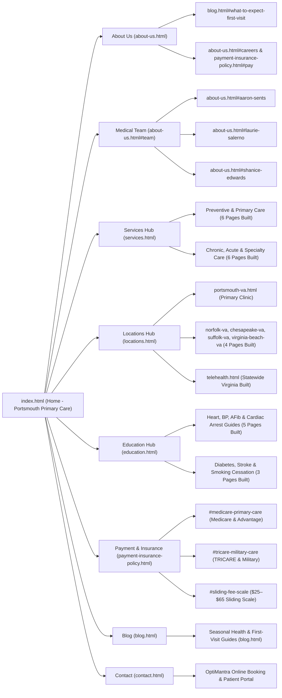
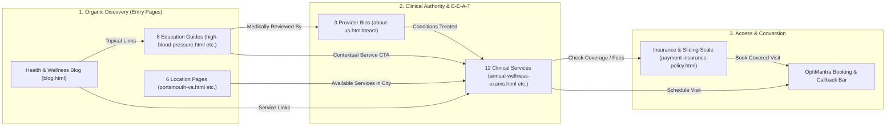

# Hampton Roads Primary Care (`htrpc.com`) — Full Site Structure & SEO Implementation Plan

## 1. Site Architecture & Internal Linking Map (Left-to-Right)

### 1A. Master Site Overview (Left -> Right)



### 1B. Internal Linking & Patient Conversion Flow (Left -> Right)



### 1C. Strategic Overview
- **Primary Clinic Location:** 355 Crawford Street, Suite 622, Portsmouth, VA 23704 (`(757) 516-7554`)
- **Primary Market:** Portsmouth, Norfolk, Chesapeake, Suffolk, Virginia Beach, and statewide Virginia via Telehealth.
- **Deployment Architecture:** 34 flat static HTML pages (`*.html` in repository root) sharing a single stylesheet (`styles.css`), interactive motion/calculator layer (`script.js`), and verified media library (`assets/`) for zero-dependency hosting on GitHub Pages or production web servers.
- **Core SEO Objectives:**
  1. **Zero URL Regression:** Preserve all 12 client clinical service slugs (`annual-wellness-exams.html`, `chronic-disease-management.html`, etc.) and core clinic slugs so existing backlinks, citations, and Google Search Console equity carry forward.
  2. **First-Party Education Hub (`education.html` + 8 Standalone Guides):** Replaced the legacy site's 8 outbound links to `cdc.gov` and `heart.org` under the **Education** menu with 8 authoritative, clinician-reviewed first-party condition guides written for Hampton Roads patients (`high-blood-pressure.html`, `hypertension-management.html`, `type-2-diabetes.html`, `heart-disease-prevention.html`, `atrial-fibrillation.html`, `stroke-warning-signs.html`, `cardiac-arrest-guide.html`, `smoking-cessation.html`).
  3. **Local SEO Service-Area Architecture (`locations.html` + 6 Location Pages):** Built dedicated hyper-local landing pages for Portsmouth (`portsmouth-va.html`), Norfolk (`norfolk-va.html`), Chesapeake (`chesapeake-va.html`), Suffolk (`suffolk-va.html`), Virginia Beach (`virginia-beach-va.html`), and statewide Virginia Telehealth (`telehealth.html`) with neighborhood drive-time tables, transit/bridge-tunnel context, and local `MedicalClinic` + `FAQPage` schema.
  4. **E-E-A-T Clinician Authority (`about-us.html`):** Highlighted each provider (Aaron Sents, PA-C; Laurie A. Salerno, ANP-BC; Shanice Edwards, NP-BC) with NPI-backed credentials, interactive clinician matching, and `reviewedBy` attribution across all 8 patient education guides.

---

## 2. Live Header Navigation Structure (Implemented Across All 34 Pages)

```text
[Hampton Roads Primary Care Logo]
├── Home (index.html)
├── About Us (about-us.html)
│   ├── About the Clinic (about-us.html)
│   ├── Our Medical Team (about-us.html#team)
│   ├── Aaron Sents, PA-C (about-us.html#aaron-sents)
│   ├── Laurie Salerno, ANP-BC (about-us.html#laurie-salerno)
│   ├── Shanice Edwards, NP-BC (about-us.html#shanice-edwards)
│   ├── What to Expect: First Visit (blog.html#what-to-expect-first-visit)
│   ├── Careers (about-us.html#careers)
│   └── Online Bill Pay (payment-insurance-policy.html#pay)
├── Services (services.html)  [Client's 12 Live Clinical Services — Mega Menu]
│   ├── Annual Wellness Exams (annual-wellness-exams.html)
│   ├── Preventive Health Screenings (preventive-health-screenings.html)
│   ├── Immunizations & Vaccinations (immunizations-and-vaccinations.html)
│   ├── Women’s Health Services (womens-health-services.html)
│   ├── Men’s Health Services (mens-health-services.html)
│   ├── Telemedicine Consultations (telemedicine-consultations.html)
│   ├── Chronic Disease Management (chronic-disease-management.html)
│   ├── Acute Illness Care (acute-illness-care.html)
│   ├── Mental Health Conditions (management-of-mental-health-conditions.html)
│   ├── Minor Injury Treatment (minor-injury-treatment.html)
│   ├── Nutrition & Weight Advice (nutrition-and-weight-management-advice.html)
│   └── Health Education & Counseling (health-education-counseling.html)
├── Locations (locations.html)  [Local SEO Pillar — 7 Pages Built]
│   ├── All Service Areas (locations.html)
│   ├── Portsmouth, VA · Primary Clinic (portsmouth-va.html)
│   ├── Norfolk, VA Primary Care (norfolk-va.html)
│   ├── Chesapeake, VA Primary Care (chesapeake-va.html)
│   ├── Suffolk, VA Primary Care (suffolk-va.html)
│   ├── Virginia Beach, VA Primary Care (virginia-beach-va.html)
│   └── Virginia Telehealth Visits (telehealth.html)
├── Education (education.html)  [First-Party Clinical Guides — Mega Menu, 9 Pages Built]
│   ├── Patient Education Library (education.html)
│   ├── High Blood Pressure Guide (high-blood-pressure.html)
│   ├── Hypertension Care Plan (hypertension-management.html)
│   ├── Heart Disease Prevention (heart-disease-prevention.html)
│   ├── Atrial Fibrillation (AFib) (atrial-fibrillation.html)
│   ├── Cardiac Arrest vs. Heart Attack (cardiac-arrest-guide.html)
│   ├── Type 2 Diabetes & A1C Guide (type-2-diabetes.html)
│   ├── Stroke Warning Signs & Care (stroke-warning-signs.html)
│   ├── Smoking Cessation Program (smoking-cessation.html)
│   └── First Visit Preparation Guide (blog.html#what-to-expect-first-visit)
├── Payment & Insurance (payment-insurance-policy.html)
│   ├── Payment & Insurance Policy (payment-insurance-policy.html)
│   ├── Medicare & Advantage Plans (payment-insurance-policy.html#medicare-primary-care)
│   ├── TRICARE & Military Families (payment-insurance-policy.html#tricare-military-care)
│   ├── Sliding Fee Scale & Self-Pay (payment-insurance-policy.html#sliding-fee-scale)
│   └── Pay Your Bill Online (payment-insurance-policy.html#pay)
├── Blog (blog.html)
├── Contact (contact.html)
└── [CTA] Patient Portal (OptiMantra Login) & Book a Visit Online
```

---

## 3. Complete Page Inventory & Build Status (34 Live HTML Pages Built)

### Pillar 1 & 2: Core Clinic, Provider E-E-A-T & Conversion Pages (6 Built Pages + Integrated Sections)
| File / URL | Status | Target Primary Keyword | Schema Types |
| :--- | :--- | :--- | :--- |
| `index.html` | **Built & Live** | primary care portsmouth va | `MedicalClinic`, `Physician`, `FAQPage` |
| `about-us.html` (`#team`, `#aaron-sents`, `#laurie-salerno`, `#shanice-edwards`, `#careers`) | **Built & Live** | hampton roads primary care portsmouth va | `MedicalClinic`, `AboutPage`, `Physician` |
| `contact.html` | **Built & Live** | primary care clinic 355 crawford st portsmouth | `MedicalClinic`, `ContactPage`, `FAQPage` |
| `payment-insurance-policy.html` (`#medicare-primary-care`, `#tricare-military-care`, `#sliding-fee-scale`, `#pay`) | **Built & Live** | primary care insurance accepted portsmouth va | `MedicalWebPage`, `FAQPage`, `BreadcrumbList` |
| `blog.html` (`#what-to-expect-first-visit`) | **Built & Live** | new patient primary care visit portsmouth va | `CollectionPage`, `Blog`, `BreadcrumbList` |
| `education.html` | **Built & Live** | patient health education hampton roads | `MedicalWebPage`, `CollectionPage`, `BreadcrumbList` |

### Pillar 3: Client's 12 Clinical Service Pages (13 Built Pages — Hub + 12 Standalone Pages)
| File / URL | Status | Target Primary Keyword | Linked Education Guides |
| :--- | :--- | :--- | :--- |
| `services.html` | **Built & Live** | primary care services portsmouth va | Links to all 12 service pages |
| `annual-wellness-exams.html` | **Built & Live** | annual physical exam portsmouth va | `heart-disease-prevention.html`, `high-blood-pressure.html` |
| `chronic-disease-management.html` | **Built & Live** | chronic disease management portsmouth va | `type-2-diabetes.html`, `high-blood-pressure.html` |
| `acute-illness-care.html` | **Built & Live** | same day sick visit portsmouth va | `stroke-warning-signs.html`, `cardiac-arrest-guide.html` |
| `preventive-health-screenings.html` | **Built & Live** | preventive health screenings portsmouth va | `heart-disease-prevention.html`, `type-2-diabetes.html` |
| `immunizations-and-vaccinations.html` | **Built & Live** | adult vaccines flu shots portsmouth va | `heart-disease-prevention.html`, `education.html` |
| `telemedicine-consultations.html` | **Built & Live** | telehealth primary care virginia | `hypertension-management.html`, `type-2-diabetes.html` |
| `womens-health-services.html` | **Built & Live** | womens health primary care portsmouth va | `heart-disease-prevention.html`, `type-2-diabetes.html` |
| `mens-health-services.html` | **Built & Live** | mens health clinic portsmouth va | `high-blood-pressure.html`, `heart-disease-prevention.html` |
| `management-of-mental-health-conditions.html` | **Built & Live** | primary care anxiety depression portsmouth va | `hypertension-management.html`, `smoking-cessation.html` |
| `minor-injury-treatment.html` | **Built & Live** | minor injury clinic portsmouth va | `stroke-warning-signs.html`, `education.html` |
| `nutrition-and-weight-management-advice.html` | **Built & Live** | medical weight management portsmouth va | `type-2-diabetes.html`, `hypertension-management.html` |
| `health-education-counseling.html` | **Built & Live** | health education counseling portsmouth va | `smoking-cessation.html`, `hypertension-management.html` |

### Pillar 4: Local SEO Location & Service-Area Pages (7 Built Pages — Hub + 6 Location Pages)
| File / URL | Status | Target Primary Keyword | Local Angle & Landmarks |
| :--- | :--- | :--- | :--- |
| `locations.html` | **Built & Live** | primary care hampton roads va | Service-area hub, interactive harbor route planner, telehealth coverage |
| `portsmouth-va.html` | **Built & Live** | primary care doctor portsmouth va | Olde Towne, Churchland, Cradock, Port Norfolk, Naval Medical Center Portsmouth, Norfolk Naval Shipyard |
| `norfolk-va.html` | **Built & Live** | primary care doctor near norfolk va | 5-min Elizabeth River Ferry / 8-min Downtown & Midtown Tunnels, Ghent, Downtown Norfolk, Naval Station Norfolk |
| `chesapeake-va.html` | **Built & Live** | primary care doctor near chesapeake va | Western Branch, Deep Creek, South Norfolk, Greenbrier via I-264 / I-464 / US-17 |
| `suffolk-va.html` | **Built & Live** | primary care doctor near suffolk va | Harbour View, Northern Suffolk, Driver, Downtown Suffolk via I-664 / I-164 / US-58 (zero tunnels) |
| `virginia-beach-va.html` | **Built & Live** | primary care doctor virginia beach telehealth | Town Center, Kempsville, Bayside, Oceanfront via I-264 W + hybrid Virginia video visits |
| `telehealth.html` | **Built & Live** | online primary care doctor virginia | Statewide HIPAA video visits for any resident physically located in the Commonwealth of Virginia |

### Pillar 5: First-Party Patient Education Hub (9 Built Pages — Hub + 8 Clinician-Reviewed Guides)
> **Why this matters for SEO:** Previously on `htrpc.com`, the 8 items under the **Education** dropdown linked directly out to `cdc.gov` and `heart.org`. All 8 guides are now hosted as first-party, clinician-reviewed pages on `htrpc.com` with `MedicalWebPage` (`reviewedBy`), `FAQPage`, clinical data tables, and an interactive target number checker.

| File / URL | Replaces Outbound Link | Status | Reviewing Clinician | Internal Service CTA |
| :--- | :--- | :--- | :--- | :--- |
| `education.html` | Live Hub Slug | **Built & Live** | Laurie Salerno, ANP-BC & Aaron Sents, PA-C | All Clinical Services |
| `high-blood-pressure.html` | `cdc.gov/bloodpressure/about.htm` | **Built & Live** | Laurie A. Salerno, ANP-BC | `chronic-disease-management.html` |
| `hypertension-management.html` | `cdc.gov/bloodpressure/facts.htm` | **Built & Live** | Laurie A. Salerno, ANP-BC | `nutrition-and-weight-management-advice.html` |
| `type-2-diabetes.html` | `cdc.gov/diabetes/basics/type2.html` | **Built & Live** | Laurie A. Salerno, ANP-BC | `chronic-disease-management.html` |
| `heart-disease-prevention.html` | `cdc.gov/heartdisease/` | **Built & Live** | Laurie A. Salerno, ANP-BC | `preventive-health-screenings.html` |
| `atrial-fibrillation.html` | `heart.org/.../atrial-fibrillation` | **Built & Live** | Laurie A. Salerno, ANP-BC | `chronic-disease-management.html` |
| `stroke-warning-signs.html` | `cdc.gov/stroke/signs_symptoms.htm` | **Built & Live** | Aaron Sents, PA-C | `preventive-health-screenings.html` |
| `cardiac-arrest-guide.html` | `cdc.gov/heartdisease/cardiac-arrest.htm` | **Built & Live** | Aaron Sents, PA-C | `preventive-health-screenings.html` |
| `smoking-cessation.html` | `heart.org/.../how-to-quit-tobacco` | **Built & Live** | Shanice Edwards, NP-BC | `health-education-counseling.html` |

---

## 4. Hub-and-Spoke Internal Linking Rules (Implemented)
1. **Every Service Page (`annual-wellness-exams.html`, etc.)** links to:
   - Its 2 most relevant **Standalone Education Guides** (e.g., `chronic-disease-management.html` -> `high-blood-pressure.html` and `type-2-diabetes.html`).
   - The **Clinician Bio Section** (`about-us.html#team`, `#aaron-sents`, `#laurie-salerno`, `#shanice-edwards`).
   - The **Locations Hub & City Pages** (`locations.html`, `portsmouth-va.html`, etc.) and **Sliding-Scale / Insurance** (`payment-insurance-policy.html`).
2. **Every Education Guide (`high-blood-pressure.html`, etc.)** includes:
   - A **"Medically Reviewed By"** fact and card linking to the reviewing clinician's bio (`MedicalWebPage` schema with `reviewedBy`).
   - A clinical reference table (`clinical-table`), the interactive **Target Number Guide** (`#target-checker`), 4 condition-specific FAQs (`FAQPage` schema), and direct CTAs to the matching Clinical Service page and OptiMantra booking.
3. **Every Location Page (`portsmouth-va.html`, etc.)** includes:
   - Neighborhood-by-neighborhood driving times & routes to **355 Crawford Street, Suite 622, Portsmouth, VA 23704**, the interactive **Harbor Route Planner** (`#route-planner`), local FAQs, and direct links to all 12 Clinical Service Pages and the $25–$65 Sliding-Scale Fee Program.

---

## 5. Phased Implementation Roadmap

### Phase 1: Frontpage & Global Navigation Foundation (Completed)
- [x] Frontpage design (`index.html`) with full Local SEO (`MedicalClinic`, `Physician`, `FAQPage` JSON-LD).
- [x] Production Header Mega-Menu with dropdowns for `About Us`, `Services` (12 clinical services), `Education` (8 owned guides + blog), `Payment & Insurance`, `Blog`, `Contact`, and `Patient Portal`. `Locations` is not in the header; it is reached via the footer.
- [x] Site-wide footer "Areas We Serve" row linking all 6 local SEO pages (Portsmouth, Norfolk, Chesapeake, Suffolk, Virginia Beach, Virginia Telehealth) from every page.

### Phase 2: Core Clinic, Team & 12 Client Service Pages (Completed)
- [x] Built core interior pages (`about-us.html`, `services.html`, `locations.html`, `education.html`, `payment-insurance-policy.html`, `blog.html`, `contact.html`) following the `colour-chapters` design system.
- [x] Built and SEO-upgraded all 12 client clinical service pages (`annual-wellness-exams.html`, `chronic-disease-management.html`, `acute-illness-care.html`, `preventive-health-screenings.html`, `immunizations-and-vaccinations.html`, `telemedicine-consultations.html`, `womens-health-services.html`, `mens-health-services.html`, `management-of-mental-health-conditions.html`, `minor-injury-treatment.html`, `nutrition-and-weight-management-advice.html`, `health-education-counseling.html`).

### Phase 3: Local SEO Location Pages (Completed)
- [x] Built `locations.html` hub + `portsmouth-va.html`, `norfolk-va.html`, `chesapeake-va.html`, `suffolk-va.html`, `virginia-beach-va.html`, and `telehealth.html` with neighborhood travel tables and `MedicalClinic` + `FAQPage` schema.

### Phase 4: First-Party Education Hub & Condition Guides (Completed)
- [x] Wrote and published all 8 first-party condition guides (`high-blood-pressure.html`, `hypertension-management.html`, `type-2-diabetes.html`, `heart-disease-prevention.html`, `atrial-fibrillation.html`, `stroke-warning-signs.html`, `cardiac-arrest-guide.html`, `smoking-cessation.html`) with `MedicalWebPage` (`reviewedBy`) and `FAQPage` schema, clinical tables, and interactive number checker.

### Phase 5: Optional Future Expansion (Semantic & Technical Assets)
- [ ] Optional standalone provider bio pages (`aaron-sents-pa-c.html`, `laurie-salerno-anp-bc.html`, `shanice-edwards-np-bc.html`) and standalone insurance sub-pages if desired beyond `about-us.html` and `payment-insurance-policy.html`.
- [ ] `sitemap.xml` and `llms.txt` machine-readable index for search engines and AI citation crawlers.
